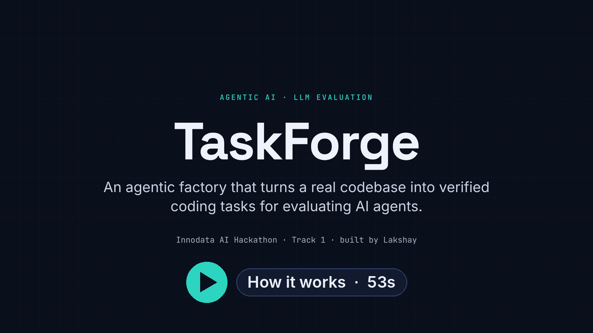
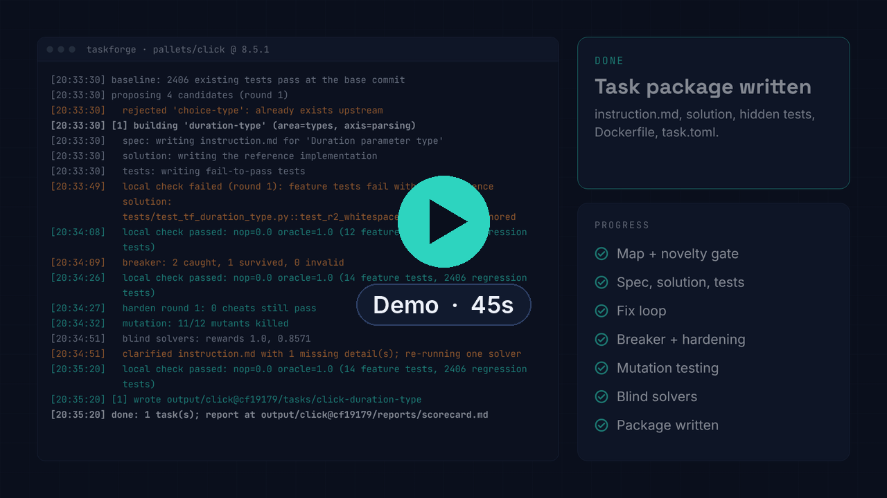
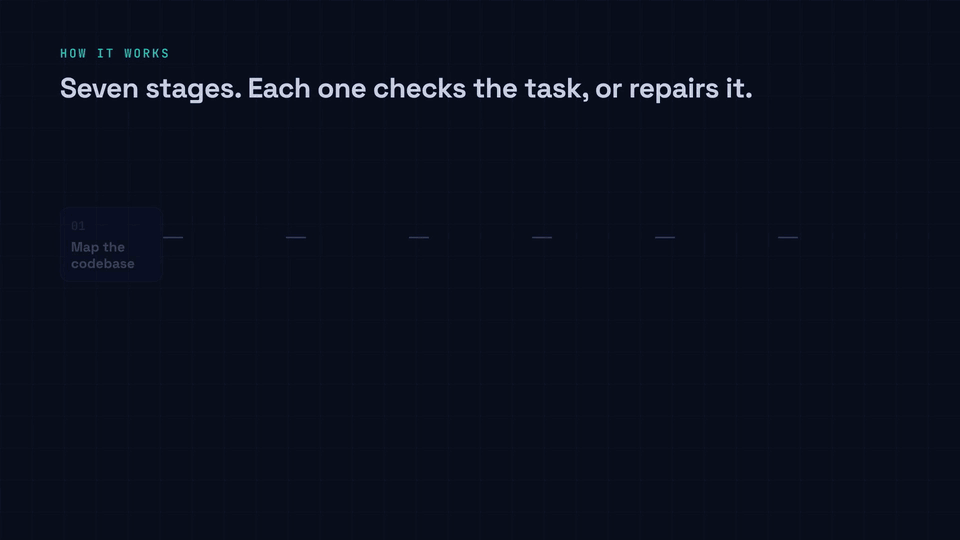
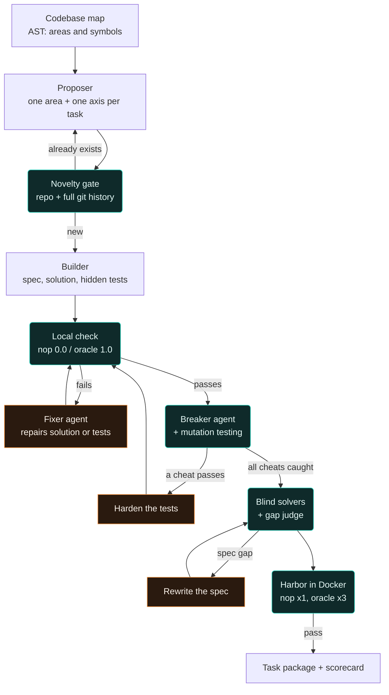
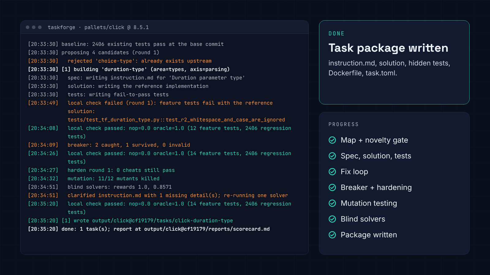
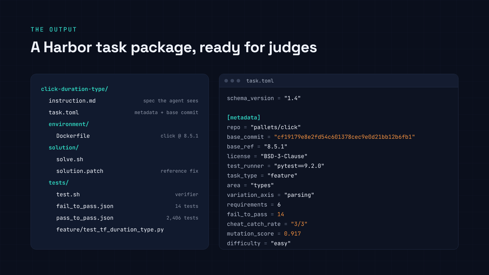

# TaskForge

[](https://github.com/lakshay57112/taskforge/actions/workflows/ci.yml)


TaskForge is a pipeline that reads a real repository and produces feature-development tasks for
evaluating AI coding agents. Each task is a [Harbor](https://pypi.org/project/harbor/) package: a
requirement document, a reference solution, hidden tests and a Docker environment pinned to an exact
commit.

Generating tasks with a model is the easy part. The hard part is trusting them, so most of TaskForge
is verification: every task has to prove that its tests fail without the feature, pass with it,
resist deliberate cheating, and describe the feature clearly enough for someone else to build it.

Built for the Innodata AI Hackathon, Track 1 (Coding Task Factory). Target repository:
[`pallets/click`](https://github.com/pallets/click) at release 8.5.1
(`cf19179e8e2fd54c601378cec9e0d21bb12b6fb1`).

<table>
<tr>
<td width="50%"><a href="docs/media/taskforge-how-it-works.mp4"></a></td>
<td width="50%"><a href="docs/media/taskforge-demo.mp4"></a></td>
</tr>
<tr>
<td align="center">How it works (53s)</td>
<td align="center">Demo: one task, end to end (45s)</td>
</tr>
</table>

## Why

- Hand-writing realistic coding tasks is slow, so benchmarks stay small.
- Public benchmarks leak into training data; fresh tasks from a pinned commit don't.
- A vague spec or a weak test produces a wrong score, and when the tasks are used for training, a
  weak test rewards cheating. Verification matters more than volume.

## How it works





| Stage | What it does | Evidence it leaves |
|---|---|---|
| Codebase map | Parses the source with `ast` into areas (a module, or one class of a large module) and indexes every symbol | `codemap.json` |
| Proposer + novelty gate | The model proposes features as JSON; each names strings that would exist if the feature already did, and those are searched in the base commit and all upstream history | rejected candidates in `rejected.json` |
| Builder | Writes `instruction.md`, a reference solution (as edit blocks) and hidden tests written from the spec only | requirement-to-test table in each task README |
| Local check + fixer | Runs the full suite on the untouched repo and with the solution; a fixer agent repairs whichever side is wrong | fix diagnoses in `logs/events.jsonl` |
| Breaker + mutation | The model writes flawed implementations aimed at the tests; survivors trigger test hardening. Mechanical mutants are injected into the solution | cheat-catch rate, mutation score |
| Blind solvers + judge | Independent attempts from the spec alone; a judge classifies each failure as a spec gap or a solver error, and gaps are written back into the spec | blind solve rate, difficulty label |
| Harbor | `nop` once (expect 0.0), `oracle` three times (expect 1.0 every time), using the commands from the participant guide | Harbor rewards per task |

## Results

The end-to-end test runs on every push in CI. It drives the real pipeline with scripted model
answers that deliberately plant a buggy reference solution, a cheat that beats the first test suite
and an ambiguous spec, then asserts that each loop catches its problem. It finishes with a real
Harbor run in Docker.

| Check | Result |
|---|---|
| Harbor in Docker (GitHub Actions) | nop **0.0**, oracle **1.0, 1.0**: PASS |
| Regression tests guarding the solution | 2,406 pass_to_pass tests |
| Feature tests | 14 fail_to_pass tests, every requirement covered |
| Fix loop | buggy first solution repaired in 1 round |
| Breaker | 1 of 3 cheats beat the first tests; after hardening, 3/3 caught |
| Mutation testing | 11/12 mutants killed |
| Blind solvers | 1 spec gap found and written back into the spec |
| Unit tests | 18 |



Live-model runs write the same metrics for every task to `output/<repo>@<commit>/reports/scorecard.md`.

## Quick start

Requirements: Python 3.12, git, Docker (for the Harbor step), and an API key for a model provider.

Windows (PowerShell):

```powershell
py -3.12 -m venv .venv
.\.venv\Scripts\Activate.ps1
pip install -e ".[harbor,dev]"
$env:GEMINI_API_KEY = "your-key"
taskforge ping                     # which models answer right now
taskforge run --tasks 1
```

Linux / macOS / WSL:

```bash
python3.12 -m venv .venv && source .venv/bin/activate
pip install -e ".[harbor,dev]"
export GEMINI_API_KEY="your-key"
taskforge run --tasks 5
```

No local Docker? Run it on GitHub instead: add your key as a repository secret, then
**Actions → Run the factory → Run workflow**. The output (task packages, scorecard, model cache) is
attached to the run as an artifact.

## Model providers

| Provider | Flag | Key variable | Default model |
|---|---|---|---|
| Google Gemini | `--provider gemini` | `GEMINI_API_KEY` | `gemini-3.8-flash`, with fallbacks |
| OpenRouter | `--provider openrouter` | `OPENROUTER_API_KEY` | `openrouter/free` |
| Groq | `--provider groq` | `GROQ_API_KEY` | `openai/gpt-oss-120b` |
| Ollama (local) | `--provider ollama` | none | `qwen2.5-coder:14b` |
| Any OpenAI-compatible API | `provider = "openai"`, `base_url`, `api_key_env` in `taskforge.toml` | | |

Model calls are treated as unreliable infrastructure. An overloaded model (503) or exhausted quota
(429) moves the request to the next configured model; a model the key cannot use (404/403) is dropped
for the rest of the run; when every model is busy the client backs off and retries within a time
budget.

## Commands

| Command | Purpose |
|---|---|
| `taskforge run [--tasks N] [--provider P] [--model M] [--skip-harbor]` | run the full pipeline |
| `taskforge run --replay` | rebuild from recorded model answers, no API key needed |
| `taskforge validate [task_dir ...]` | Harbor nop/oracle matrix on existing packages |
| `taskforge check task_dir ...` | fast local nop/oracle check without Docker |
| `taskforge ping [models ...]` | check which models answer right now |
| `taskforge models` | list models available to your key |
| `taskforge codemap` | print the codebase map |
| `taskforge report` | rebuild the scorecard from the task folders |

## Task package

```
click-duration-type/
  instruction.md            requirement document, the only file the agent sees
  task.toml                 repo, base_commit (40 chars), licence, provenance, quality metrics
  environment/Dockerfile    click fetched at the exact commit, test dependencies pinned
  solution/solve.sh         applies solution/solution.patch (Harbor's oracle agent runs this)
  tests/test.sh             verifier: restores the test suite, runs pytest, writes the reward
  tests/taskforge_verify.py outcome recorder + reward rule, the same code the pipeline uses
  tests/fail_to_pass.json   new feature tests
  tests/pass_to_pass.json   existing regression tests
  tests/feature/*.py        hidden feature tests
```

Reward: any regression test failing gives 0.0; otherwise the share of feature tests that pass.



## Design decisions

**Verification over generation.** Every stage either produces evidence or repairs the task. A
candidate that cannot be repaired within its budget is dropped and a spare candidate takes its place.

**Edit blocks, not diffs.** Models are unreliable at writing unified diffs (hunk headers, context
drift). The model returns search/replace blocks, which are applied to a clean git worktree and
rejected if they touch anything outside `src/`; `git diff` then produces the patch.

**Tests come from the spec, never from the solution.** This keeps tests on behaviour instead of
implementation details, and it is what makes the blind-solver check meaningful: if an independent
attempt built from the spec fails a test, either the spec is unclear or the attempt is wrong, and a
judge decides which.

**One scorer.** `taskforge_verify.py` is a pytest plugin plus the reward rule. The pipeline uses it
for local checks and ships it inside every task, so local and Harbor scores cannot drift apart.

**Local first, Docker last.** The local nop/oracle check takes seconds and runs inside every repair
loop; Harbor builds containers and runs once per task at the end. Tests that behave differently on the
host and in the container are found from the nop run and removed from `pass_to_pass` (calibration).

**A hardened shared verifier.** The verifier runs in the agent's container, as SWE-bench-style tasks
do. Before grading it restores `tests/` and the pytest config from the base commit and removes any
added `conftest.py`, `pytest.ini` or `sitecustomize.py`. An attempt that edits a test or injects a hook
that forces passes still scores 0.0.

**Reproducible by construction.** Every model answer is cached under `.taskforge_cache/`, keyed by a
hash of the full request, with a transcript of request order. Test output is normalised (paths,
timings, addresses) before it reaches a prompt. `taskforge run --replay` rebuilds the same packages
with no API key.

**The pipeline is tested like a product.** LLM pipelines are hard to test; the scripted-model
end-to-end test plants specific failures and asserts that each loop catches its own, so a regression
in any repair path fails CI.

More detail in [docs/TECHNICAL.md](docs/TECHNICAL.md).

## Limitations and next steps

- One repository profile today (Python + pytest). The pipeline is repository-agnostic in structure;
  profiles for `colinhacks/zod` (vitest) and `jsoncpp` (CMake/ctest) are next.
- Blind solvers are single model calls, a proxy for clarity and difficulty. Running full agents
  through Harbor would give real difficulty numbers.
- The verifier shares the agent's container. A separate-verifier mode would also rule out tampering
  with the installed test runner.
- Equivalent mutants cannot be detected automatically and lower the mutation score slightly.

## Repository layout

```
taskforge/
  cli.py          command line
  pipeline.py     orchestration, spare candidates, scorecard
  codemap.py      stage 1: AST map, patch-to-symbol mapping, overlap metric
  propose.py      stage 2: proposals, novelty gate, diversity selection
  builder.py      stage 3: spec, solution, tests, local check and repair loop
  breaker.py      stage 4: Breaker agent, test hardening, mutation testing
  blind.py        stage 5: blind solvers, gap judge, spec rewrite
  harbor.py       stage 6: Harbor runs, reward parsing, pass_to_pass calibration
  package.py      stage 7: Harbor task folder
  llm.py          providers, routing and fallbacks, response cache and replay
  localcheck.py   local test runner and nop/oracle check
  prompts/        one prompt per stage
  templates/      taskforge_verify.py (shipped inside every task)
tests/            unit tests and the scripted end-to-end run
```

## Development

```bash
pytest tests/test_units.py                          # unit tests
TASKFORGE_E2E=1 pytest tests/test_end_to_end.py     # full pipeline with a scripted model
```

## License

MIT for TaskForge. Generated tasks contain code derived from click (BSD-3-Clause).
